# Visual comparisons

96 accepted version-2 captures form 48 matched pairs: 12 screen families × French/Arabic × mobile 390×844 / desktop 1440×1000. Another 8 after-only checks cover 320px light registration/payment and 390px dark rules/card. The independent static fallback has 8 original/final renders at 390/1440px in light/dark.

Before is the frozen pre-interface checkout (`dda4bea4`, identical UI to starting `5d84f58f`); after is this implementation. Fresh synthetic mock sessions, matching explicit feature flags, language/direction assertions immediately before/after capture, loaded fonts/content and scrollY=0 form the capture contract. Asia/Dubai timezone and the real browser clock are recorded. Adjacent captures may differ in countdown minutes; they are not frozen-time fixtures. No provider/payment/production action was executed.

Rejected first-paint French frames under Arabic filenames and interrupted/corrupted initial manifests were excluded. The final manifest requires actual `ar`/`rtl` and visible Arabic heading for Arabic captures, with `captureVersion: 2`, `accepted: true` and no pending viewport correction. Final pairs were inspected by the visual specialist; the independent reviewer lists exactly which full images they personally opened.

The full exact rasters are in `/workspace/botolago-ux-audit-evidence/comparisons`. Committed overviews below show both languages, before on the left and after on the right. Selected exact full-page/viewport/lower-scroller rasters are in [evidence](evidence/). [Manifest](VISUAL-MANIFEST.json) and [measurements](VISUAL-MEASUREMENTS.csv) provide matching metadata; [specialist report](specialists/VISUAL-FINAL.md) explains interpretation.

## Useful content position

Values measure document coordinates of the same first useful form/data element, rather than scroll-relative positions. Positive advance means the element moved upward. This is a local layout observation, not a measured task-completion improvement.

| Screen · mobile | French advance | Arabic advance |
| --- | ---: | ---: |
| register | 49.38px | 32.59px |
| top-players | 55.38px | 38.59px |
| rules | 177.62px | 169.27px |
| setup-step3 | 49.38px | 32.59px |

## Mobile comparisons

### plus-payment

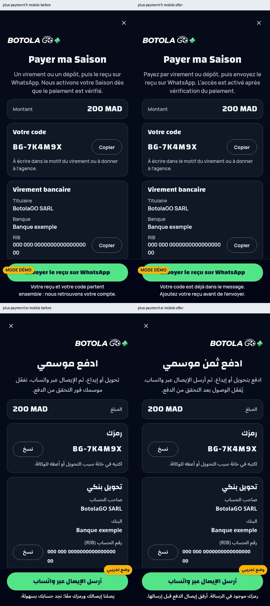

### plus-offer

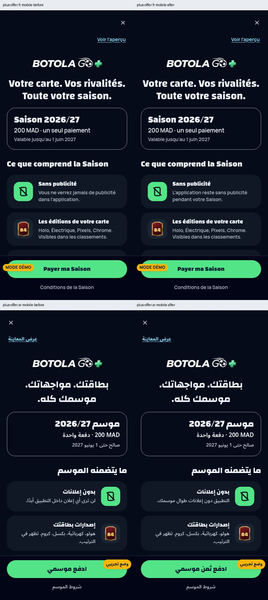

### briefing

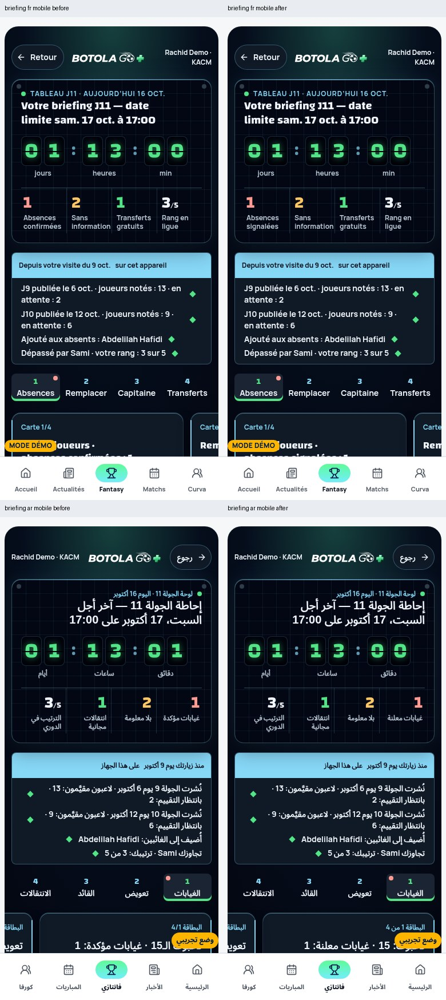

### register

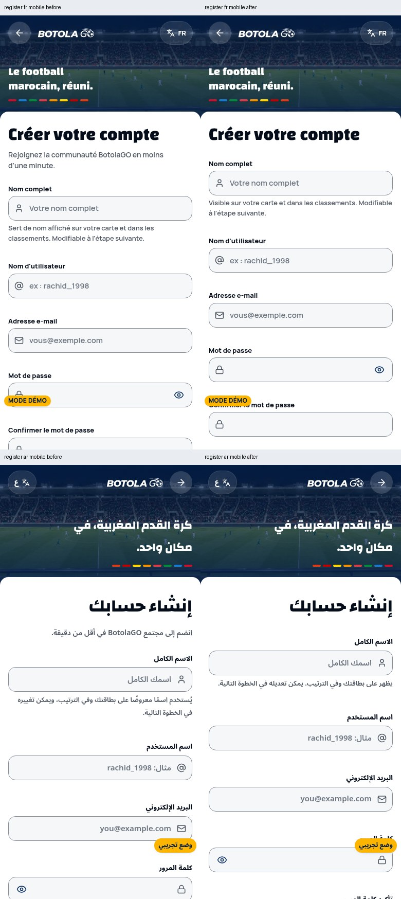

### top-players

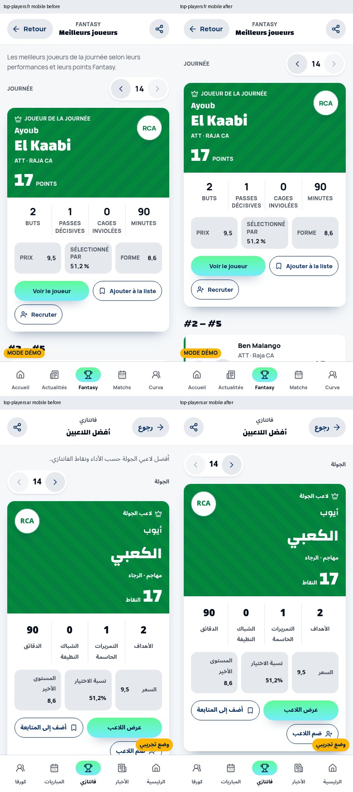

### rules

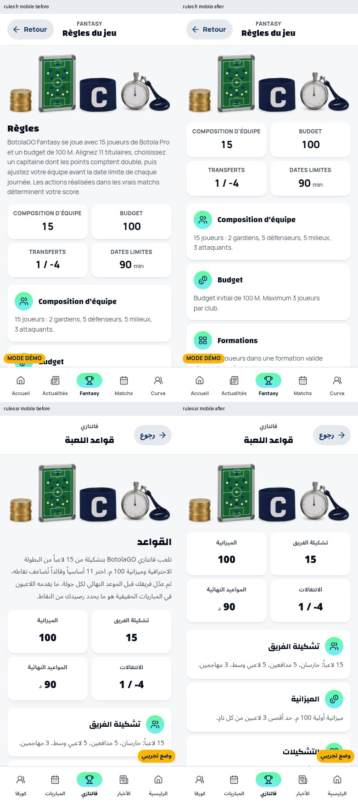

### setup-step3

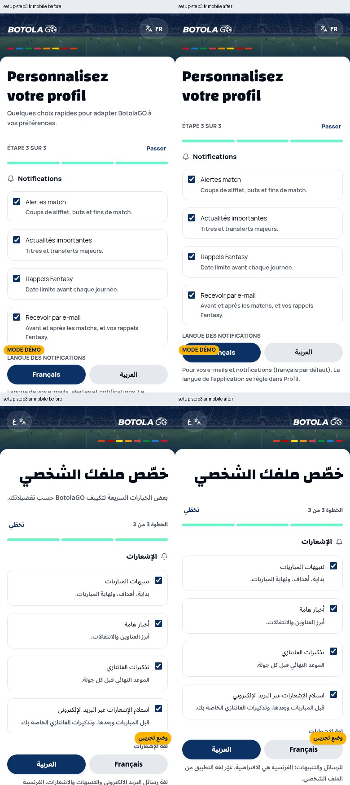

### curva-card

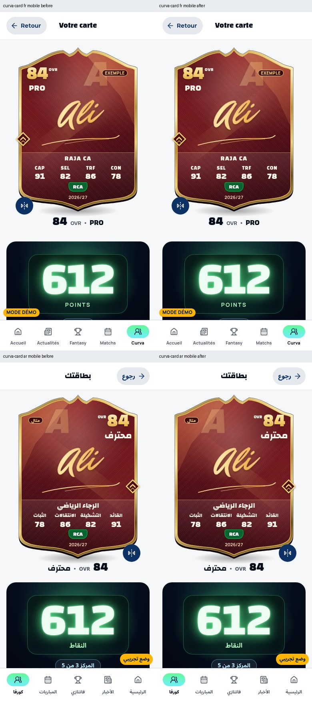

### profile

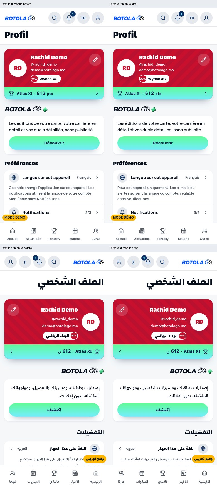

### notifications-guest

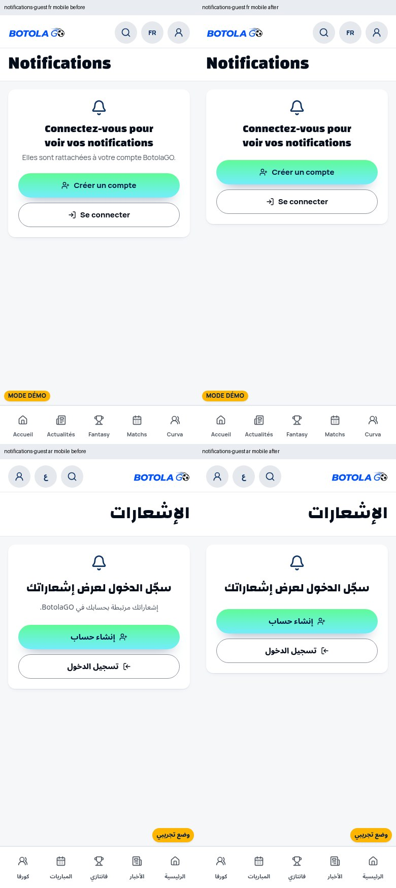

### saved-guest

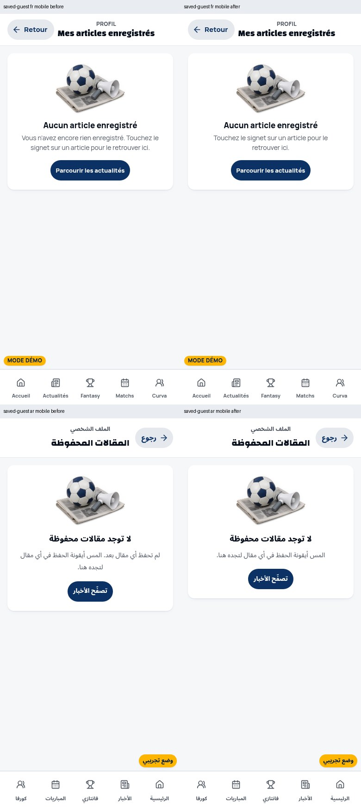

### prospects

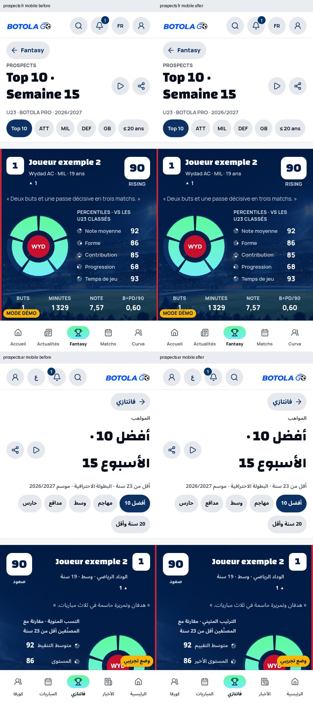

## Desktop comparisons

Selected desktop views are included below; all 12 desktop families have accepted exact rasters and overview files.

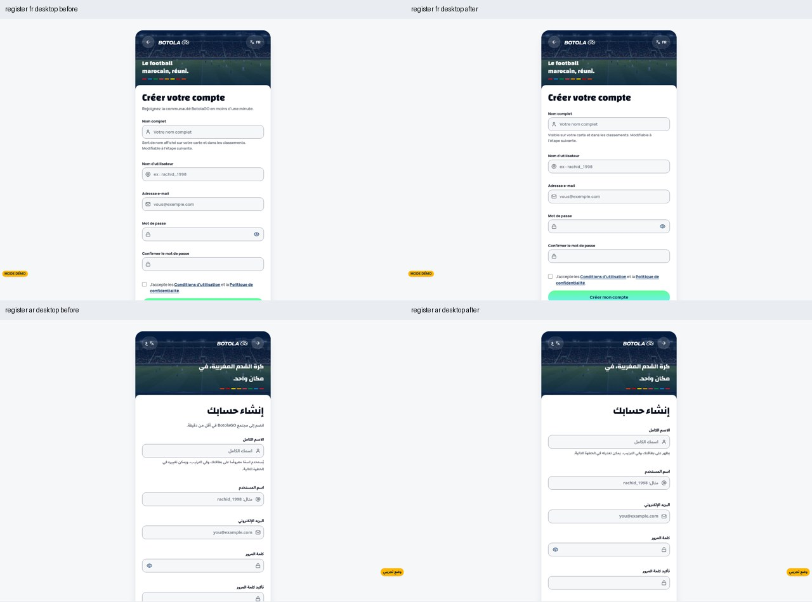

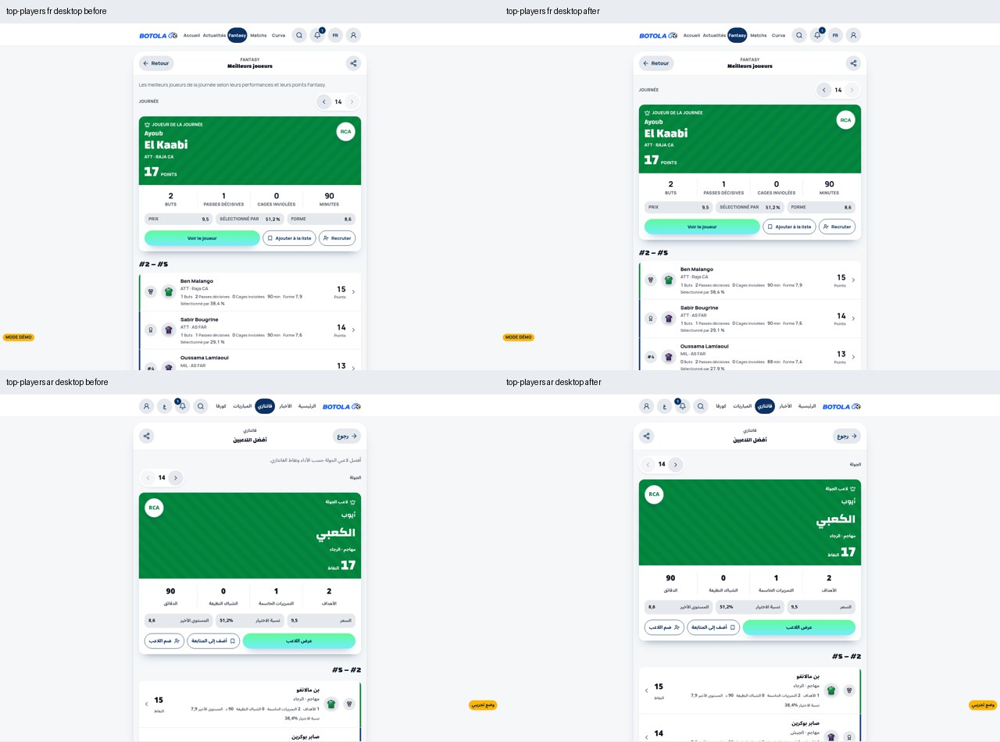

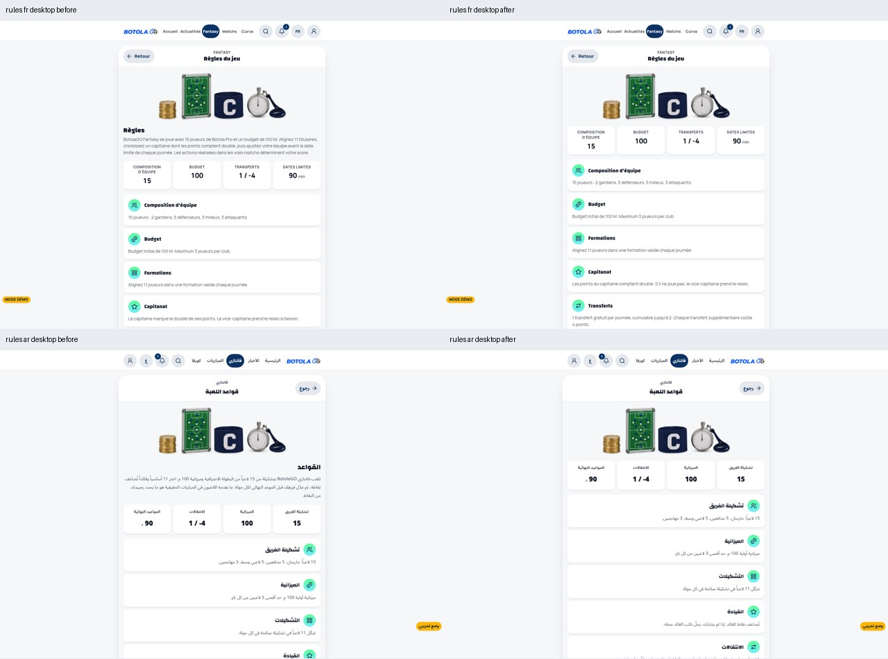

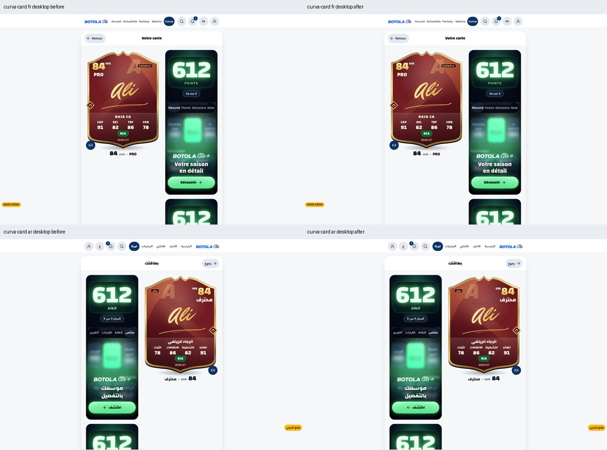

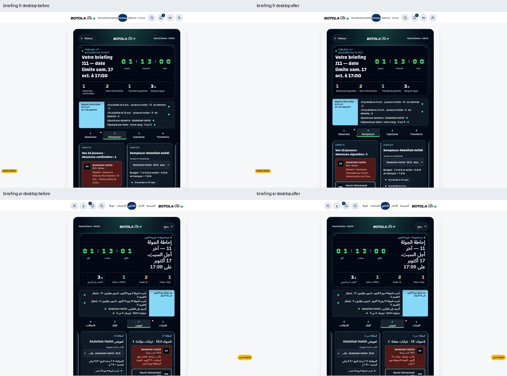

## Standalone error recovery

The app-independent bilingual error page now fits the390px viewport and exposes recovery targets at least 44px high. Existing colours and actions are unchanged. Actual HTML from `renderErrorPage()` was rendered outside the app in light and dark; the original English HTML is the genuine before state.

| Before · dark390 | After · dark390 |
| --- | --- |
| 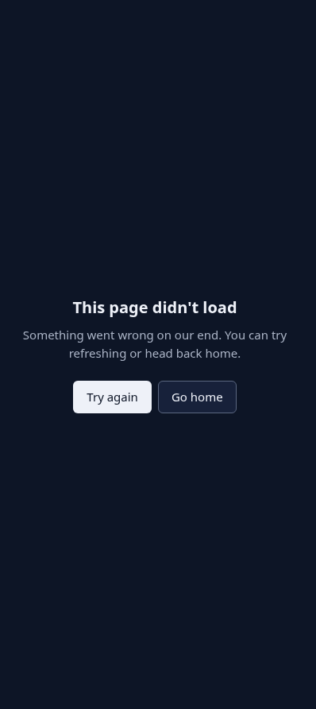 | 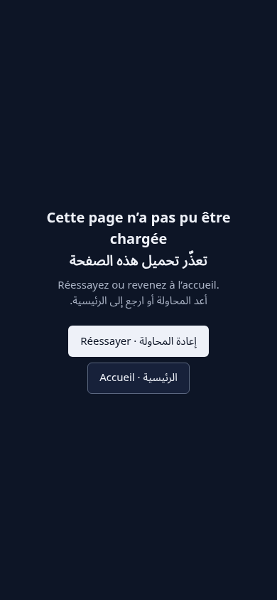 |

## Limits and existing issues

No new offscreen/clipped text candidates were recorded in the accepted changed-screen checks; this bounded DOM check does not establish universal accessibility. Necessary payment details and lower-scroller receipt instructions were inspected. The existing RIB wraps legibly on phones. Desktop Curva still leaves substantial empty space beside its narrow secondary column. The Arabic desktop briefing deadline can remain dense with large deck whitespace. Existing RTL match-date rail positioning is outside this pass. No numerical contrast audit, screen-reader certification, native-device or production verification is claimed. Source-only staff/authentication states are detailed in [coverage](COVERAGE.md).
